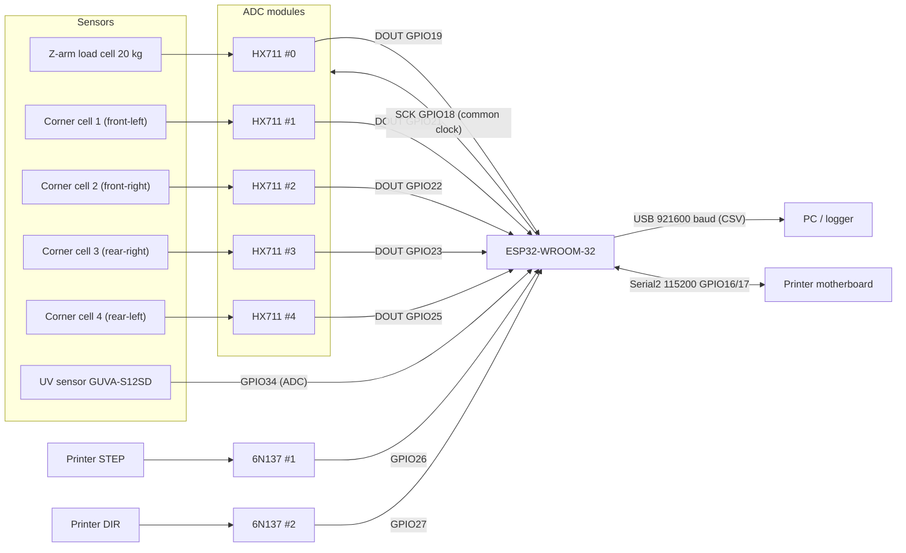

# MSLA Force Bench — Detection System Specification

Written in Simplified Technical English (ASD-STE100).
Audience: development engineers who build and integrate the solution.
Status: specification of the implemented design in this repository.

---

## 1. Introduction

### 1.1 Purpose
This document tells you how to build the MSLA force bench and its detection system.
It gives the parts list, the assembly steps, the firmware, and the detection method.
Use this document to make a working unit.

### 1.2 Scope
The document has these parts:
- the detection concept;
- the bill of materials (BOM);
- the mechanical assembly;
- the electrical connections;
- the firmware and the software;
- the serial protocol to the printer motherboard;
- the verification tests;
- the performance data.

### 1.3 System summary
The force bench changes an MSLA resin printer into a measurement tool.
It measures three signals, layer by layer:
- the force on the build platform (Z arm);
- the position of the Z axis;
- the state of the UV light.

With these signals, the system does two functions:
- it finds faults during a print (detachment, support failure, debris, loose film);
- it checks the resin vat before a print (debris, platform level, resin quantity, leak).

The system sends the measurements on USB. It sends verdicts to the printer motherboard
on a second serial link.

---

## 2. Terms and abbreviations

| Term | Meaning |
|---|---|
| MSLA | Masked stereolithography (LCD resin printer) |
| ADC | Analog-to-digital converter |
| HX711 | 24-bit ADC for load cells |
| Load cell | Force sensor (beam type) |
| Z arm | The link between the Z carriage and the build platform |
| Vat | The resin tank with the transparent film at the bottom |
| FEP | The transparent film at the bottom of the vat |
| Peel force | The force to pull a cured layer off the film |
| Layer | One cured slice of the part |
| SPS | Samples per second |
| Verdict | The result of the detection (OK, PAUSE, or STOP) |
| Firmware | The program in the microcontroller |
| Motherboard | The control board of the printer |

---

## 3. Detection concept

### 3.1 Signals and phases
In each layer, the platform does a cycle. The firmware gives a phase to each sample:

| Phase | Name | Platform |
|---|---|---|
| 4 | Bottom wait | Down, UV off, before exposure |
| 0 | Exposure | Down, UV on |
| 1 | Peel | Moves up (pulls the layer off the film) |
| 3 | Top wait | Up, stopped |
| 2 | Descent | Moves down to the next layer |

The firmware finds the phase from the Z movement and the UV state.
The motherboard gives the layer number and the UV state on the serial link.

### 3.2 Layer features
For each layer, the firmware calculates four values (features):
- **peak** — the maximum peel force in phase 1;
- **comp** — the minimum (most negative) force in the descent and the next bottom wait;
- **travel** — the Z position at the peak;
- **stat** — the change of the end-of-exposure force between two layers.

### 3.3 In-print detection (learning)
The firmware learns the normal level from the last 6 good layers.
It divides the peak and the compression by the layer area to remove the area effect.
Then it compares each new layer to the learned level.

The firmware sets a flag when a layer is not normal:

| Flag | Condition (summary) | Meaning |
|---|---|---|
| CRASH | comp ≤ −0.93 × Fmax | The motor is blocked or crushes the part |
| OBSTACLE | comp much more negative than normal | An obstacle stops the descent |
| APPUI | stat below the threshold | A foreign body gives a residual load |
| FAIBLE | peak much lower than normal | The peel force is too low (detachment is probable) |
| FEP | travel/peak too high | The film is loose |

Note: The firmware needs 3 good layers before it starts the analysis.
Note: If 4 FAIBLE layers come one after the other, the firmware learns the new level.
This prevents false alarms when the part area changes correctly.

### 3.4 Verdicts to the motherboard
The firmware changes the flags into a verdict for each layer:

| Flag | Verdict |
|---|---|
| CRASH | STOP CRASH \<n\> |
| OBSTACLE | STOP OBSTACLE \<n\> |
| APPUI | PAUSE APPUI \<n\> |
| FAIBLE | PAUSE FAIBLE \<n\> |
| FEP | PAUSE FEP \<n\> |
| (none) | OK \<n\> |

A danger gives STOP. A recoverable fault gives PAUSE. A good layer gives OK.

**Warning:** The bench does not stop the printer. The motherboard makes the decision.
A STOP is a request. The motherboard must cut the UV and lift the platform.

### 3.5 Vat control before a print
The vat control uses a special test file: one black layer with a slow descent and a
5-second wait at the bottom. During this test, the firmware measures the platform force.
It gives one of these results:
- **OK** — the vat is clean;
- **RESIDU** — the firmware found debris, with a risk level (moderate, high, or danger);
- with 4 vat load cells, it also gives the position of the debris.

The firmware uses a reference that you record one time on a clean vat.

### 3.6 Vat, resin, and planarity (option, 4 load cells)
With 4 load cells below the vat, the system also does these functions:
- **Weigh** — it finds the vat, a bad vat position, and the resin quantity;
- **Leak** — it measures a loss of weight for 30 minutes;
- **Planarity** — it measures the tilt of the platform and the lowest side.

---

## 4. Bill of materials (BOM)

There are two configurations:
- **Minimum** (`cells 1`): the Z arm only — in-print detection and basic vat control;
- **Full** (`cells 5`): with 4 vat load cells — weigh, position, leak, and planarity.

| Qty | Part | Specification | Function | Config |
|---|---|---|---|---|
| 1 | Microcontroller board | ESP32 DevKit (ESP32-WROOM-32) | Measurement, calculation, USB and motherboard link | All |
| 1 | Beam load cell | 20 kg (10 kg is enough on a small printer) | Force on the Z arm | All |
| 1 | ADC module | HX711 | Reads the Z arm load cell | All |
| 1 | UV sensor | GUVA-S12SD (or a direct pickup of the UV LED signal) | Finds the exposure | All |
| 2 | Fast optocoupler | 6N137, with 330 Ω and 10 kΩ resistors | Picks up STEP and DIR safely | All |
| — | Cable | Shielded, 4 conductors, connectors, sleeve | Sensor connections | All |
| — | Mechanical parts | 3D-printed or machined brackets | Adapters for the Z arm and the cell | All |
| 4 | Beam load cell | 10 kg (vat corners) | Weigh, position, leak, planarity | Full |
| 4 | ADC module | HX711 | Reads the 4 corner load cells | Full |

Indicative budget: 25 to 45 EUR. Z arm about 10 EUR; 4 corners about 20 EUR.

**Caution:** The Z arm load cell must have a capacity equal to or more than the maximum
Z motor force. If not, a crush event can break the cell.

---

## 5. Mechanical assembly

### 5.1 Z arm load cell
The Z arm load cell goes between the Z carriage and the platform support.

1. Attach one end of the cell to the Z carriage.
2. Attach the other end to the platform support.
3. Put the arrow on the cell in the direction of the pull to the vat.
4. Make sure that no cable touches the machine during the Z movement.

Note: The beam cell adds a small flexibility (some hundredths to tenths of a millimeter
at full load). Print a test part and compare the first layers with and without the cell.

### 5.2 Vat corner load cells (option)
Install one cell below each corner of the vat. Give them these numbers (front view):
1 = front-left, 2 = front-right, 3 = rear-right, 4 = rear-left.

1. Put a cell below each corner.
2. Keep the vat with a lateral guide but with no vertical friction.
3. Put a plastic spacer between each cell and the screen to keep the heat away.
4. Do the printer level procedure again, because the vat is now higher.

**Caution:** If the vat has vertical friction on the guides, a part of the force does not
go through the cells. The measurement is then not correct.

### 5.3 UV sensor
Select one of two methods:
- put the GUVA-S12SD sensor at the edge of the screen, out of the vat, towards the light;
- or (more reliable) pick up the UV LED command signal through an optocoupler.

### 5.4 STEP and DIR pickup
STEP and DIR are the signals from the motherboard to the Z motor driver.

1. Find STEP and DIR on the driver socket or on test points.
2. Connect the LED of a 6N137 to STEP through a 330 Ω resistor. Connect the cathode to
   the printer ground.
3. Connect the output of the 6N137 to the ESP32 with a 10 kΩ pull-up resistor to 3.3 V.
4. Do the same for DIR.

Note: The two circuits stay electrically separate. This protects the printer.
Note: If you cannot find STEP and DIR, use a VL6180X laser distance sensor on the
platform instead. This needs a change in the firmware.

---

## 6. Electrical connections

Connect the ESP32 as in this table:

| ESP32 pin | Connected to |
|---|---|
| 3V3 / GND | VCC / GND of all HX711 modules and the UV sensor |
| GPIO 18 | SCK of all HX711 modules (common clock) |
| GPIO 19 | DOUT of the Z arm HX711 (cell 0) |
| GPIO 21, 22, 23, 25 | DOUT of the corner HX711 modules (cells 1 to 4) |
| GPIO 26 | STEP of the Z driver, through an optocoupler |
| GPIO 27 | DIR of the Z driver, through an optocoupler |
| GPIO 34 | Analog output of the UV sensor |
| GPIO 16 / 17 | RX2 / TX2 — serial link to the motherboard (see section 8) |

Load cell to HX711: red E+, black E−, white A−, green A+. Check the data sheet of the cell.

**Caution:** Keep DIR on a GPIO lower than 32. The firmware reads DIR with a fast
register function that works only below GPIO 32.

**Warning:** For 80 SPS, cut the RATE pin of the HX711 (pin 15 of the chip) from ground
and connect it to +3.3 V. If the RATE pin stays on ground, the rate is 10 SPS.

### 6.1 Block diagram



Note: The 4 corner cells and their HX711 modules are the "Full" configuration only.

### 6.2 Load cell and HX711 wiring

Each load cell connects to its own HX711 module. All HX711 modules share the clock (SCK)
and the power. Only the DOUT line is individual.

```
 Load cell                 HX711 module                 ESP32
 ---------                 ------------                 -----
 red   E+ -----------------> E+
 black E- -----------------> E-
 green A+ -----------------> A+
 white A- -----------------> A-
                            VCC <----------------------- 3V3
                            GND <----------------------- GND
                            SCK <----------------------- GPIO18   (common to all modules)
                            DOUT -----------------------> GPIO19   (cell 0; 21/22/23/25 for 1..4)
                            RATE ----------------------- +3V3      (for 80 SPS; see Warning above)
```

Caution: Check the wire colors against the data sheet of your load cell. The colors above
are the most common code, but they change between suppliers.

### 6.3 STEP and DIR optocoupler circuit

Use one 6N137 for STEP and one for DIR. The two circuits are the same. The optocoupler
keeps the printer side and the ESP32 side electrically separate.

```
   Printer side                     6N137 (DIP-8)                 ESP32 side
   ------------                     -------------                 ----------
                            +3V3 ---+--- [8] VCC
                                    +--- [7] VE (enable)
                                              |
   STEP ---[330 ohm]--->|--- [2] anode        |          +3V3 ---[10k ohm]---+
                            [3] cathode        |                              |
                               |              [6] VO (output) ----------------+--- GPIO26 (STEP)
   Printer GND ----------------+          [5] GND --- ESP32 GND
```

Pin function of the 6N137: 2 = anode, 3 = cathode, 5 = GND, 6 = output (open collector,
needs the pull-up), 7 = enable (tie to VCC), 8 = VCC. Pin 1 is not used.

For DIR, use the same circuit with the printer DIR signal and GPIO27.

Caution: Keep DIR on GPIO27 (below GPIO32). The firmware reads DIR with a fast register
function that works only below GPIO32.

---

## 7. Firmware and software

### 7.1 Architecture
The software has two parts:
- a portable C++ library (`lib/msla_detect/`) with all the detection logic;
- the ESP32 firmware (`firmware/banc_msla/banc_msla.ino`) that reads the sensors and
  uses the library.

The library has no dynamic memory and no Arduino dependency. The same library runs on
the ESP32 and on a PC for the tests. For the software architecture, the public API, the
data flow, the thresholds, and the extension points, see `docs/SOFTWARE_DEV_GUIDE.md`.
The library has these modules:

| Module | Function |
|---|---|
| msla_filtres | Median, 3-point median, moving average |
| msla_couche | Layer features, learning, verdict (batch and streaming) |
| msla_stabilite | Resin settle measurement |
| msla_bac | Vat control, planarity, weigh, leak |

### 7.2 Build and upload
1. Install Arduino IDE 2.
2. In the board manager, add the Espressif ESP32 package.
3. Open `firmware/banc_msla/banc_msla.ino`.
4. Select the board "ESP32 Dev Module".
5. Upload the firmware.

Note: The Arduino IDE compiles the `src/` folder of the sketch. This folder is a link to
`lib/msla_detect/`. On Windows, if the link does not work, copy the `lib/msla_detect/`
folder into `firmware/banc_msla/src/msla_detect/`.

### 7.3 Calibration procedure
Do the calibration one time after the assembly. Use the serial terminal at 921600 baud,
line end LF. Type `aide` to show the commands.

1. Type `cells 1` for the Z arm only, or `cells 5` for the 4 corners.
2. Type `tare` with no load on the platform.
3. Hang a known mass from the platform. Type `cal 0 <grams>`.
4. Type `stepsmm <value>` for the Z axis (steps per millimeter).
5. Move the platform up 10 mm. Type `info` and make sure that Z increased by 10.
6. If Z decreased, type `dir`.
7. Set the UV thresholds with `uv <high> <low>`.

Note: The firmware keeps the settings in memory after a power-off.

### 7.4 USB data format
The firmware sends one CSV line for each sample on USB (921600 baud):

```
t_s,fz_N[,c0_N,c1_N,c2_N,c3_N],z_mm,uv,uv_raw
```

The sign convention is: plus for a pull on the film (peel), minus for compression.

### 7.5 Vat control procedure
1. Clean the vat.
2. Type `ref`. Start the test file. The firmware records the reference.
3. For a check, type `controle`. Start the test file. The firmware gives the verdict.

The test file is one black layer, with a slow descent and a 5-second wait at the bottom.

**Warning:** The bench cannot stop the printer during the test. A large and hard debris
gets the full motor force before you can do an action. Always do a cleaning layer and
filter the resin after a failed print.

### 7.6 Detection settings
You can change these settings (not kept in memory unless noted):

| Command | Function | Default |
|---|---|---|
| `maintien <s>` | Bottom wait time of the test | 5 s |
| `seuils <push> <descent>` | Vat thresholds in newtons | 0.3 and 0.4 |
| `bac <width> <depth>` | Distance between the vat cells (mm) | 200 and 125 |
| `couche <mm>` | First layer thickness | 0.05 |
| `fmax <N>` | Maximum Z motor force | 140 |

---

## 8. Serial protocol to the motherboard

The bench and the motherboard communicate on the ESP32 Serial2 port.
The full specification is in `firmware/PROTOCOLE.md`. This is a summary.

### 8.1 Physical layer
- Port: Serial2 (UART2), pins RX2 = GPIO16, TX2 = GPIO17.
- Speed: 115200 baud, 8N1.
- Lines end with LF. The motherboard is the master.

### 8.2 Motherboard to bench

| Message | Function |
|---|---|
| `L <n> [area]` | Start of layer n; area is the exposed area in mm² |
| `U 1` / `U 0` | UV on / off |
| `V` | Do the vat control; the bench answers VAT … |
| `P` / `R` | Pause / resume |
| `X` | Stop the print; the bench finalizes the last layer |
| `?` | Ask the state; the bench answers RDY |

### 8.3 Bench to motherboard

| Message | Function |
|---|---|
| `RDY` | The bench is ready |
| `VAT OK` / `VAT RESIDU` / `VAT ERREUR` | Result of the vat control |
| `OK <n>` | Layer n is good |
| `PAUSE <code> <n>` | Recoverable fault at layer n |
| `STOP <code> <n>` | Danger at layer n |
| `ALRM FORCE` | The force is above the alarm threshold |
| `ERR` | The bench did not understand the message |

Note: Give the exposed area with each `L` message. The area makes the detection correct
when the layer area changes. Without the area, the detection is less reliable.

Note: The bench sends the verdict of layer n at the start of the peel of layer n+1.
The motherboard gets `STOP OBSTACLE 30` while it starts layer 31.

### 8.4 Reserved
The messages `WAIT` and `GO` (hold the exposure until the resin is stable) are in the
protocol but the firmware does not send them yet. The library can measure the settle
time (`msla_stabilite`). An engineer can connect this function to Serial2 later.

---

## 9. Verification

Run the automatic tests on a PC. They need node, g++, and python3 with numpy.

| Test | Command | Checks |
|---|---|---|
| Simulator model | `node tests/simulateur.test.js` | The physical model and the detection |
| Library parity | `bash tests/lib/run.sh` | The C++ library gives the same verdicts as the simulator |
| Vat control | `bash tests/firmware_host/run.sh` | The vat control on synthetic records |
| Serial protocol | `bash tests/protocole/run.sh` | The protocol commands and the vat verdict |
| In-print detection | `bash tests/couche_live/run.sh` | The fault is found at the correct layer, with no false alarm |
| Geometry (10.1″ study) | `python3 tests/test_fusion_geometrie.py` | The Fusion 360 design geometry |

A continuous integration job (`.github/workflows/tests.yml`) runs all these tests on each
change.

**Note on the method:** The simulator makes test scenarios (force traces and the correct
verdict from ground truth). The C++ library replays the traces and must give the same
verdict. This method confirms that the firmware detection is correct before you have the
hardware.

---

## 10. Performance data

The analysis tools are in `tests/perf/` (`bash tests/perf/run.sh`). The results:

### 10.1 Real-time budget
- To read 5 load cells takes about 170 µs (the HX711 modules use a common clock).
- At 80 SPS, the period is 12.5 ms. The CPU uses about 1.4 % of the time to read.
- The USB link uses about 5 % of its capacity. The motherboard link uses less than 0.1 %.
- More than 90 % of the CPU time is free for the detection.

### 10.2 Detection calculation cost
- The mean cost is about 0.05 µs for each sample on a PC.
- The worst case is about 37 µs (the sample that finalizes a layer).
- The budget is 12.5 ms. The margin on the PC is about 340 times.
- The estimated worst case on the ESP32 is about 1.8 ms. This is much below 12.5 ms.

Note: The ESP32 value is an estimate. It is not measured on the hardware.

### 10.3 Noise robustness
- There is no false alarm at the nominal noise level.
- The system finds a clear fault (detachment, support failure) up to about 8 times the
  nominal noise.
- The debris signal is the weakest. It stops at about 6 times the nominal noise.
- Keep a safety margin of about 4 to 5 times. To get more margin, use a shielded cable, a
  common ground, and a finer load cell.

---

## 11. Warnings and limitations

**Warning:** The bench measures only. It does not stop the printer. The motherboard must
do the stop action.

**Warning:** During the vat test, a large and hard debris gets the full motor force before
a stop is possible. Clean and filter the resin after each failed print.

**Caution:** The vat control cannot see a debris out of the platform area, or a debris
thinner than the first layer.

**Caution:** The in-print detection gives the verdict of a layer one layer later (at the
peel of the next layer). The motherboard must accept this delay.

**Note:** The machine and resin profiles are generic. Only a calibration on your records
gives correct values for your machine.
